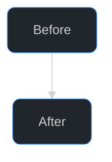
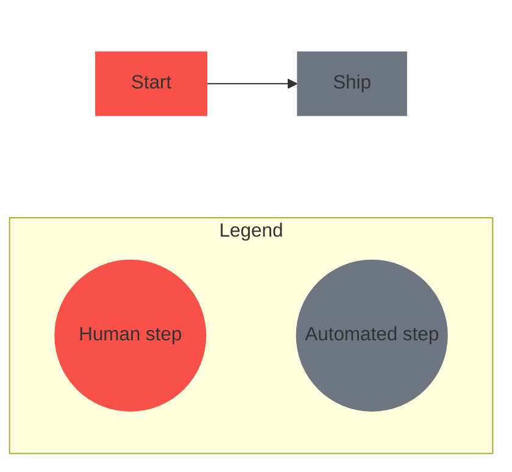

# Diagrams, maps, and 3D models in PR/issue bodies and docs

Loaded from `SKILL.md` whenever a diagram, map, or model is going into a PR body, issue body, or doc. Covers which format to pick and the GitHub-rendering mechanics for it, not body structure, see `references/body-writing.md` for when to use one and where it fits inside a body.

## Choosing the format

GitHub renders four fenced diagram syntaxes in issues, discussions, PRs, wikis, and Markdown files: `mermaid`, `geojson`, `topojson`, and `stl` (ASCII only). Pick by the shape of the content, not by habit. The default is not a flowchart: reach for a flowchart only when the content is a flow.

| Content | Use | Syntax reference |
| --- | --- | --- |
| Steps, branching, old vs. new flow, system context | `flowchart` | [flowchart](https://mermaid.js.org/syntax/flowchart.html) |
| Who calls whom, in order, across services | `sequenceDiagram` | [sequence](https://mermaid.js.org/syntax/sequenceDiagram.html) |
| Work items with dates, durations, or dependencies: rollout plan, migration phases, release schedule | `gantt` | [gantt](https://mermaid.js.org/syntax/gantt.html) |
| Dated events with no durations: incident timeline, version history | `timeline` | [timeline](https://mermaid.js.org/syntax/timeline.html) |
| Lifecycle or status transitions | `stateDiagram-v2` | [state](https://mermaid.js.org/syntax/stateDiagram.html) |
| Tables, keys, relationships | `erDiagram` | [entity relationship](https://mermaid.js.org/syntax/entityRelationshipDiagram.html) |
| Types, interfaces, inheritance | `classDiagram` | [class](https://mermaid.js.org/syntax/classDiagram.html) |
| Branch and merge history | `gitGraph` | [gitgraph](https://mermaid.js.org/syntax/gitgraph.html) |
| Share of a whole (few categories) | `pie` | [pie](https://mermaid.js.org/syntax/pie.html) |
| Flow volumes between stages | `sankey-beta` | [sankey](https://mermaid.js.org/syntax/sankey.html) |
| Numeric series: latency, counts over time, benchmarks | `xychart-beta` | [xychart](https://mermaid.js.org/syntax/xyChart.html) |
| Two-axis prioritization (impact vs. effort) | `quadrantChart` | [quadrant](https://mermaid.js.org/syntax/quadrantChart.html) |
| Hierarchy or brainstorm | `mindmap` | [mindmap](https://mermaid.js.org/syntax/mindmap.html) |
| Components with explicit layout | `block-beta` | [block](https://mermaid.js.org/syntax/block.html) |
| Cloud or infra topology | `architecture-beta` | [architecture](https://mermaid.js.org/syntax/architecture.html) |
| Binary protocol or header layout | `packet-beta` | [packet](https://mermaid.js.org/syntax/packet.html) |
| Work-in-progress board | `kanban` | [kanban](https://mermaid.js.org/syntax/kanban.html) |
| Multi-metric comparison across a few items | `radar-beta` | [radar](https://mermaid.js.org/syntax/radar.html) |
| Part-to-whole hierarchy sized by value | `treemap-beta` | [treemap](https://mermaid.js.org/syntax/treemap.html) |
| Traceability of requirements | `requirementDiagram` | [requirement](https://mermaid.js.org/syntax/requirementDiagram.html) |
| Software architecture levels (system, container, component) | `C4Context` and siblings | [C4](https://mermaid.js.org/syntax/c4.html) |
| User experience steps with satisfaction scores | `journey` | [user journey](https://mermaid.js.org/syntax/userJourney.html) |
| Places, regions, coordinates, routes | `geojson`, or `topojson` for shared-boundary data | [GeoJSON spec](https://datatracker.ietf.org/doc/html/rfc7946), [TopoJSON spec](https://github.com/topojson/topojson-specification) |
| A 3D part or shape | `stl` | [ASCII STL](https://en.wikipedia.org/wiki/STL_(file_format)#ASCII_STL) |

Read the linked syntax page before writing a type you haven't used in this session: the keywords and indentation differ per chart, and GitHub shows "Unable to render rich display" for a slip. The `mermaid.js.org` pages document the latest release, so a feature newer than GitHub's version (see the `info` check below) fails to render even when the docs show it.

Decision rules:

- **Table when the reader looks things up; diagram when the reader follows a path or compares in space or time.** A comparison of options across attributes, or a list of settings, is a Markdown table. A schedule, a dependency order, or a flow is a diagram. Data that fits in 3 rows by 3 columns is prose or a table, never a chart.
- **Anything with a time axis defaults to `gantt` (durations, overlap, dependencies) or `timeline` (events only).** A bulleted or tabular schedule with start and end dates is a signal to use `gantt`, without being asked.
- **Prefer the plainest type that carries the point.** A `pie` of two slices is a sentence. A `mindmap` of a linear list is a list.
- **Geographic content is `geojson`/`topojson`, not a mermaid approximation.** Use `topojson` only when the data already is TopoJSON. Coordinates go in `[longitude, latitude]` order, and the block stays small: a large payload goes in a linked `.geojson` file, which GitHub also renders.
- **`stl` is for a 3D model the change actually concerns** (a CAD part, a printed bracket). Never decorative. A large model goes in a committed `.stl` file, not inline.
- **Verified against GitHub's renderer (Mermaid v12.2.0, tested in a scratch gist):** every type in the table above renders, including the `*-beta` ones, `kanban`, `radar-beta`, and `treemap-beta`, with the exact keywords shown. `zenuml` does not: it fails with "No diagram type detected". Use `sequenceDiagram` instead. GitHub's build changes over time, so rerun the `info` check below before relying on a type the table doesn't list or a non-`-beta` spelling.

Check which Mermaid version GitHub currently ships (a chart type newer than that fails with "Unable to render rich display"):

````text
```mermaid
  info
```
````

The theme and legend sections below are flowchart mechanics. Other types take their own syntax, so confirm the init directive applies before copying it onto them (a `gantt` uses `%%{init: {"theme": "dark"}}%%`, for example, with no `flowchart` key). Every chart still follows the screen-reader rule under Known GitHub limitations: the lead-in sentence states the takeaway.

## Theme and styling

GitHub strips custom CSS from PR and issue bodies, but a `%%{init: ...}%%` directive still sets a dark theme, node padding, and rounded corners on both GitHub and the Copilot app. Open every flowchart with this combination:



Don't drop `padding` below 14: wide multi-line `<br/>` labels crowd the rounded border at 8px and below.

`theme: dark` holds box contrast in either GitHub light/dark mode, and `nodeBorder` matches GitHub's accent blue. Skip per-link arrowhead colors, arrowheads always inherit the line's color. Skip `font-weight` too, GitHub's fonts only ship regular and bold, so in-between values snap to one of them.

## Legends for color-coded diagrams

Mermaid has no built-in legend support ([mermaid-js/mermaid#2110](https://github.com/mermaid-js/mermaid/issues/2110) is still open). Once `style`/`classDef` fills distinguish categories, add a legend so the reader doesn't have to guess what each color means. Build one as a titled subgraph of same-size swatch nodes, forced below the diagram it explains, joined by invisible links (`~~~`) so they lay out in a row instead of stacking:



Three details make it render right on GitHub, plus one optional polish:

- **Give the subgraph a real title.** `subgraph Legend["Legend"]`, not `subgraph Legend[ ]`: GitHub renders the bracketed text as the heading, and an empty one leaves the box unlabeled.
- **Force every swatch to the same size.** A circle node (`((...))`) sizes to its own label, so "Human step" renders smaller than "Automated step". Wrap each label in a fixed-width `<p style='width:7rem;margin:0px;'>`, one width wide enough for the longest label.
- **Force the legend below the diagram, not floating above it.** A `Legend` subgraph with no edges into the main flow is a disconnected component, and Mermaid renders those above the flow regardless of source order. Wrap the real diagram in `subgraph Main[ ]` with `direction LR` (keeps its left-to-right layout), hide the wrapper with `style Main fill:none,stroke:none`, switch the outer graph to `flowchart TB`, and declare an invisible link last (`Main ~~~ Legend`). The outer `TB` stacks `Main` above `Legend` without changing the diagram's internal layout.
- **Scale it down, optionally.** A full-size legend competes with the diagram. Give the swatches their own `classDef`s (`legHuman`/`legAutomated`), never the main flow's `human`/`automated`: a shared class would shrink the main flow's nodes too. Add a smaller `font-size` to the legend-only classes:

```mermaid
classDef legHuman fill:#f85149,stroke-width:0px,font-size:9px
classDef legAutomated fill:#6e7681,stroke-width:0px,font-size:9px
```

  and change the `<p style='width:...'>` above to `width:4.5rem`: `7rem` is sized for the default 16px font and truncates "Automated step" once shrunk.

Keep legend labels to one or two words naming the category, not restating the diagram.

## Known GitHub limitations

GitHub's [known issues for Mermaid](https://docs.github.com/en/repositories/working-with-files/using-files/working-with-non-code-files#known-issues), plus the failures documented in this file:

- **Sequence diagrams render with extra padding below the chart**, growing with chart size. GitHub attributes this to the Mermaid library. Keep sequence diagrams short, or use a `flowchart`.
- **Popover menus on sequence-diagram actor nodes don't work.** Don't rely on actor links or menus to carry information; put it in the node label.
- **Not every chart type is accessible to screen readers.** Never let the diagram be the only place a fact lives: the lead-in above it states the takeaway in prose.
- **Two edge patterns fail with "Unable to render rich display", though mermaid.live renders both.** Use the fix shown for each:
  - A dotted edge whose target is defined inline with `:::`: `A -.-> T[Target]:::risk`. Declare the node first (`T[Target]:::risk`), then draw the edge with the bare id (`A -.-> T`)
  - An edge pointed at a subgraph's own id: `consumers --> Backend` where `Backend` is `subgraph Backend[...]`. GitHub's build only allows a real node as an edge endpoint, so use `consumers --> ingest`, where `ingest` is a node inside the subgraph
- **Layout tricks diverge between builds.** Nested subgraphs, cluster-to-cluster invisible links, and HTML labels forcing node size differ from mermaid.live too, see the section below.

## Verifying a diagram actually renders right on GitHub

A diagram that looks right in an editor preview, a CLI chat preview, or a third-party renderer isn't proof it renders on GitHub: each is a different Mermaid build, and the layout tricks under Known GitHub limitations are where they diverge. GitHub renders Mermaid in its own sandboxed `viewscreen.githubusercontent.com` iframe, so only a live PR/issue preview or comment shows what a reader sees.

Before shipping a diagram that leans on a layout trick, paste it into a scratch gist (`gh gist create scratch.md`; secret by default, never `--public`, since node labels can name internal systems) and open it, which renders through the same pipeline as a PR or issue body. Delete the gist once confirmed. A plain flowchart without nested subgraphs or invisible links doesn't need this.
